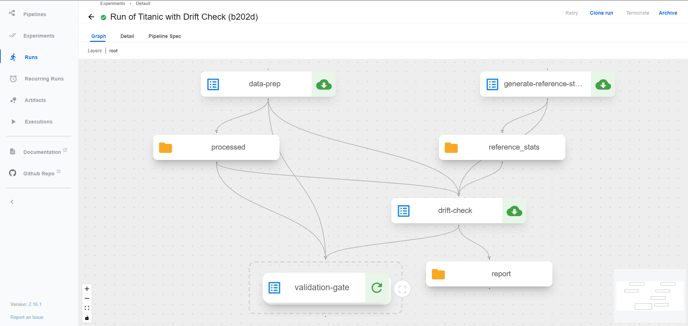
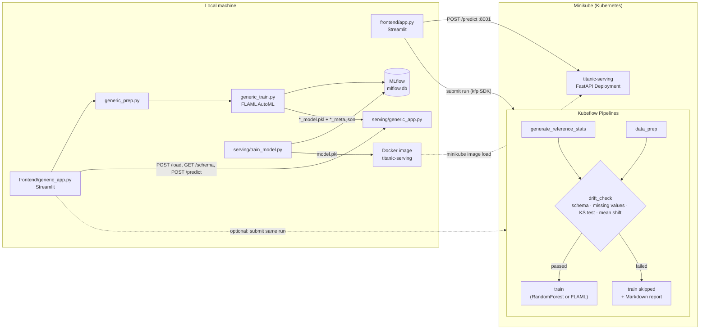

# MLOps Platform on Kubernetes (Minikube)

An end-to-end MLOps platform running on a local, single-node Kubernetes cluster
(Minikube), built during an internship. It has two versions that share the same
ideas: data preparation, a data-validation and drift gate, training, tracking,
serving and a web frontend.

- **Titanic version.** This is a Kubeflow Pipelines (KFP) pipeline with a custom
  drift-check component that blocks training when the data has drifted. A
  FastAPI model server runs as a Kubernetes Deployment, and a Streamlit frontend
  ties it together.
- **Generic AutoML version.** You give it a well-formed tabular CSV and pick the
  target column. It cleans the data, detects classification vs regression,
  trains with FLAML AutoML, logs to MLflow and serves the model through an API
  whose input schema follows the trained model. There is also a
  dataset-agnostic KFP pipeline.



## What runs where

| Part | Where it runs |
|---|---|
| Kubeflow Pipelines 2.16.1 (standalone) | Kubernetes (Minikube) |
| Titanic pipeline: `pipelines/titanic_pipeline.py` + `components/` | Kubernetes (KFP) |
| Titanic serving API: `serving/app.py`, `serving/k8s/` | Kubernetes (Deployment + Service in namespace `serving`) |
| Generic KFP pipeline: `pipelines/generic_pipeline.py` | Kubernetes (KFP). **Validated end to end on Iris only.** |
| Titanic local training + MLflow logging: `serving/train_model.py` | Local |
| Generic prep / FLAML training: `generic_prep.py`, `generic_train.py` | Local |
| Generic serving API: `serving/generic_app.py` | Local (uvicorn) |
| Streamlit frontends: `frontend/app.py`, `frontend/generic_app.py` | Local |
| MLflow tracking (SQLite `mlflow.db`) and UI | Local |

## Architecture



The drift gate works the same way in both pipelines. Reference statistics come
from the clean data. `drift_check` runs a Kolmogorov–Smirnov test and a
mean-shift check (default: p < 0.05, or a shift of more than 2 standard
deviations). It also checks the schema and the missing-value rate (default
20%). Training only runs inside a `dsl.If` when every check passes. Setting
`drift_mode=True` injects synthetic drift so you can watch the gate close.

## Repository layout

```
.
├── components/                 # KFP components for the Titanic pipeline
│   ├── drift_check.py          #   schema / missing-value / KS + mean-shift gate
│   └── generate_reference_stats.py
├── pipelines/
│   ├── titanic_pipeline.py     # Titanic KFP pipeline (compile / submit)
│   └── generic_pipeline.py     # dataset-agnostic KFP pipeline (FLAML)
├── serving/
│   ├── train_model.py          # trains Titanic RF locally, logs to MLflow, writes model.pkl
│   ├── app.py                  # Titanic FastAPI server (Docker image)
│   ├── Dockerfile
│   ├── feature_cols.json
│   ├── k8s/                    # Deployment + Service (namespace "serving")
│   └── generic_app.py          # generic FastAPI server (/schema, /predict, /load)
├── frontend/
│   ├── app.py                  # Titanic Streamlit app
│   └── generic_app.py          # generic AutoML Streamlit app
├── generic_prep.py             # generic cleaning + task-type detection
├── generic_train.py            # FLAML AutoML training + MLflow logging
├── scripts/
│   ├── setup.ps1 / setup.sh    # Minikube + KFP 2.16.1 install, then port-forward
│   ├── port-forward.ps1 / .sh  # re-expose the KFP UI on :8082
│   ├── deploy-serving.ps1      # build + deploy the Titanic serving image, port-forward :8001
│   ├── download_demo_datasets.py
│   └── make_messy_demo.py
├── data/                       # only titanic.csv is committed, see data/README.md
├── .streamlit/config.toml      # Streamlit theme
└── requirements.txt
```

## Ports

| Service | URL |
|---|---|
| KFP UI | http://localhost:8082 (not 8080, which was taken by another service on the development machine) |
| Serving API (Titanic via port-forward, or generic via uvicorn) | http://localhost:8001 |
| Streamlit | http://localhost:8501 |
| MLflow UI | http://localhost:5000 |

Both serving APIs use port 8001, so run only one of them at a time.

## Quick start (Windows 11, PowerShell)

**Prerequisites:** Docker Desktop, Minikube, kubectl and Python 3.10+ (the
project was developed on Python 3.13). The cluster needs 4 CPUs, 8 GB RAM and
a 40 GB disk.

Run every command from the repository root, because several scripts use paths
relative to it.

```powershell
git clone https://github.com/Mahmoud-ben-khelil/MLOps-Platform-on-Kubernetes.git
cd MLOps-Platform-on-Kubernetes
python -m venv .venv
.\.venv\Scripts\Activate.ps1
pip install -r requirements.txt
```

### 1. Cluster and Kubeflow Pipelines

```powershell
.\scripts\setup.ps1          # minikube start + KFP 2.16.1, then port-forwards the UI to :8082
```

The script ends by running the port-forward in the foreground, so leave that
terminal open. After a later `minikube start`, run
`.\scripts\port-forward.ps1` to expose the UI again. Bash versions of both
scripts are in `scripts/`.

### 2. Titanic pipeline on KFP

```powershell
python pipelines/titanic_pipeline.py            # compile only -> pipelines/titanic_pipeline.yaml
python pipelines/titanic_pipeline.py --submit   # clean run: validation passes, train runs
python pipelines/titanic_pipeline.py --drift    # drifted run (Age +30, Fare x8 +100): train is skipped
```

The pipeline pods download the Titanic CSV from the pandas GitHub repository,
so the cluster needs internet access.

### 3. Titanic serving on Kubernetes

The image needs `serving/model.pkl`, and that file isn't committed.
`serving/train_model.py` generates it, so **it must exist before you build the
image**. The deploy script handles this: it trains the model when the file is
missing.

```powershell
.\scripts\deploy-serving.ps1
```

The script runs these steps:

1. `python serving/train_model.py`, only if `serving/model.pkl` is missing. This
   trains on `data/titanic.csv`, logs to MLflow and writes `serving/model.pkl`
   and `serving/feature_cols.json`.
2. `docker build -t titanic-serving:latest serving/`
3. `minikube image load titanic-serving:latest`. The Deployment uses
   `imagePullPolicy: Never`.
4. Creates the namespace `serving` if it doesn't exist.
5. `kubectl apply -f serving/k8s/`, then a rollout restart so a rebuilt image
   is picked up.
6. `kubectl port-forward -n serving svc/titanic-serving 8001:80`, in the
   foreground.

To retrain the served model, delete `serving/model.pkl` and run the script
again.

Test the endpoint:

```powershell
$body = @{ Pclass=1; Sex="female"; Age=29.0; SibSp=0; Parch=0; Fare=100.0; Embarked="S" } | ConvertTo-Json
Invoke-RestMethod -Uri "http://localhost:8001/predict" -Method POST -Body $body -ContentType "application/json"
```

> **Version note:** `serving/Dockerfile` pins the same Python (3.13),
> scikit-learn, numpy and pandas versions as `requirements.txt`, because
> `model.pkl` is pickled in that environment and pickles aren't guaranteed to
> load across versions. If you change one, change both.

### 4. Titanic frontend

```powershell
streamlit run frontend/app.py     # http://localhost:8501
```

The app sends predictions to `localhost:8001` and submits clean or drifted KFP
runs (with hyperparameters) to `localhost:8082`.

### 5. MLflow

```powershell
mlflow ui --backend-store-uri sqlite:///mlflow.db    # http://localhost:5000
```

`serving/train_model.py` logs to the experiment `titanic-hyperparameter-tuning`
and `generic_train.py` logs to `generic-automl`. Runs with non-default
hyperparameters are logged but don't overwrite `serving/model.pkl`:

```powershell
python serving/train_model.py --n-estimators 200 --max-depth 8
```

### 6. Generic AutoML version (local)

Get the demo datasets (see [data/README.md](data/README.md)):

```powershell
python scripts/download_demo_datasets.py
python scripts/make_messy_demo.py
```

**Command line:**

```powershell
python generic_prep.py data/penguins.csv species                       # -> data/penguins_clean.csv
python generic_train.py data/penguins_clean.csv species --time-budget 30
# -> data/penguins_clean_model.pkl + data/penguins_clean_meta.json, plus an MLflow run
```

`generic_train.py` also accepts `--task-type classification|regression`,
`--out-dir` and `--experiment`.

**Serve a trained model:**

```powershell
$env:MODEL_NAME = "penguins_clean"     # loads data/penguins_clean_model.pkl
uvicorn serving.generic_app:app --port 8001
```

Use `MODEL_PATH` for a full path instead. With neither variable set, the
server loads `data/titanic_clean_model.pkl`, so that model has to exist first.
The server has these endpoints: `GET /health`, `GET /schema`, `POST /predict`
and `POST /load` (swaps in another model without restarting).

**Streamlit app:**

```powershell
streamlit run frontend/generic_app.py     # http://localhost:8501
```

The workflow is: upload a CSV, pick the target column, check the detected task
type, then train locally (generic_prep + FLAML). The app then asks the serving
API on :8001 to load the new model and builds a prediction form from its
`/schema`. If KFP is reachable, it also tries to submit the same run to the
generic pipeline. It does this by serving `data/uploads/` on port 8765 so the
pod can fetch the file through `host.minikube.internal`. That submission is
best effort; the local result doesn't depend on it.

### 7. Generic pipeline on KFP

```powershell
$env:PYTHONUTF8="1"; python pipelines/generic_pipeline.py --submit `
    --csv-url "https://raw.githubusercontent.com/mwaskom/seaborn-data/master/iris.csv" `
    --target-column species
```

Use `--drift` instead of `--submit` to perturb every numeric feature and close
the gate. The CSV URL has to be reachable from inside the cluster. This
pipeline has only been validated end to end with the Iris URL above.

## Generic AutoML: what "generic" means here

The generic version targets **well-formed tabular CSVs where the user picks the
target column**. `generic_prep.py` applies fixed rules:

- Drop feature columns with more than 50% missing values.
- Drop all-unique (ID-like) columns.
- Drop categorical columns with more than 50 unique values that are also more
  than 50% unique.
- Fill gaps with the median (numeric) or the mode (categorical).
- Label-encode categoricals as integers.
- Treat a target as **classification** if it's non-numeric, has at most 20
  distinct values, or has a distinct-value ratio of at most 5%. Otherwise treat
  it as regression.

It doesn't handle text, dates, images, multi-file datasets or targets that need
domain-specific feature engineering.

## Results (generic version, run locally)

Each figure is a single FLAML AutoML run, scored on a 20% held-out test split
(`random_state=42`). The model is the one FLAML selected, as recorded in each
run's `*_meta.json`.

| Dataset | Task | Metric | Score | Model selected |
|---|---|---|---|---|
| Palmer Penguins | classification | accuracy | 0.985 | extra_tree |
| Wine | classification | accuracy | 0.972 | extra_tree |
| Breast Cancer | classification | accuracy | 0.982 | lgbm |
| Adult Income | classification | accuracy | 0.873 | xgboost |
| Wine Quality (red) | classification* | accuracy | 0.66 | xgb_limitdepth |
| California Housing | regression | R² | 0.85 | xgboost |
| Diabetes | regression | R² | 0.45 | sgd |

\* `quality` has only 6 distinct values, so the task-type rule treats it as
classification.

## Limitations

- Single-node Minikube. This is a local demo platform, not a production
  deployment.
- No automatic retraining and no monitoring or alerting. The drift gate only
  runs when a pipeline run is submitted.
- No authentication on any service (KFP UI, serving APIs, Streamlit, MLflow).
- While `frontend/generic_app.py` is running, it serves `data/uploads/` over
  plain HTTP on port 8765, bound to all interfaces (`0.0.0.0`). This is
  deliberate: when the app submits a run to KFP, the pipeline pod downloads the
  uploaded CSV from `http://host.minikube.internal:8765/...`. From inside
  Minikube that name points to the host's address on the Docker network, not
  to its loopback interface, so a `127.0.0.1` binding would be unreachable. As
  a result, other machines on your network can also read uploaded files while
  the app runs. Use it on a trusted network, or block port 8765 in the
  firewall for anything outside the Docker network.
- The model a pipeline trains is not pushed to the serving endpoint
  automatically. The Titanic image is built from the locally trained
  `serving/model.pkl`.
- MLflow only logs the local training runs (`serving/train_model.py`,
  `generic_train.py`), not the KFP pipeline runs.
- The generic KFP pipeline has only been validated end to end on Iris.

## Licence

No licence has been chosen yet. Until one is added, all rights are reserved by
default.
